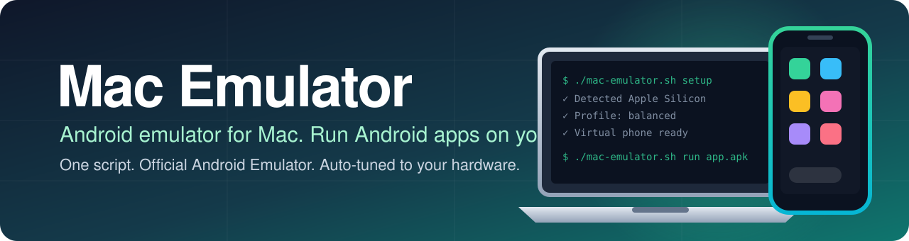
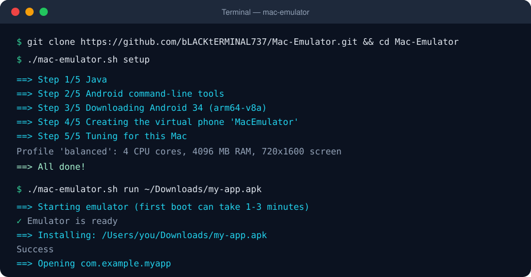
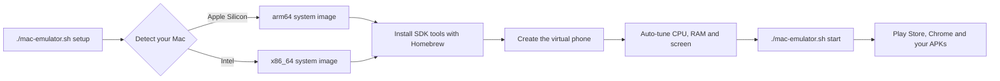

<p align="center">
  
</p>

<p align="center">
  
  
  
  
  
  
</p>

<p align="center">
  <b>A free, open-source, BlueStacks-style Android emulator for your Mac, built in one command.</b><br>
  It uses Google's official Android Emulator and tunes itself to <i>your</i> Mac's CPU, RAM and chip.
</p>

---

## ✨ Why Mac Emulator?

| | |
|---|---|
| 🧩 **One script** | `./mac-emulator.sh setup` installs Java, the Android SDK tools, a system image and creates a virtual phone. |
| 🍏 **Apple Silicon and Intel** | Detects your chip and downloads the matching image (`arm64-v8a` or `x86_64`). |
| ⚡ **Tuned to your Mac** | Picks CPU cores, RAM and screen size from your hardware (see [profiles](#-auto-tuning-profiles)). |
| 🛒 **Play Store and Chrome included** | Uses the Google Play system image, so you can sign in and install apps like on a real phone. |
| 📦 **Install APKs your way** | Drag and drop, or `./mac-emulator.sh run app.apk`. `.xapk` files work too (experimental). |
| 🆓 **Free and official** | No ads, no accounts, no third-party emulator. Everything comes from Google's own tools. |

<p align="center">
  
</p>

---

## 🚀 Quick start

> **You need:** a Mac, [Homebrew](https://brew.sh), and about **15 GB** of free disk space.

```bash
# 1. Get the project
git clone https://github.com/bLACKtERMINAL737/Mac-Emulator.git
cd mac-emulator

# 2. One-time setup (downloads a few GB, takes a while)
chmod +x mac-emulator.sh
./mac-emulator.sh setup

# 3. Start the phone
./mac-emulator.sh start
```

A phone window opens with **Google Chrome** and the **Play Store**. Sign in with a Google account and install any app you like.

Want to install an APK file instead?

```bash
./mac-emulator.sh run ~/Downloads/my-app.apk
```

> 💡 You can also **drag and drop** an `.apk` onto the emulator window.

> ⚠️ Paste only the commands, **not the `# comments`**. Some Terminal setups treat `(` in a comment as an error.

---

## 🧠 How it works



Mac Emulator is a thin, readable wrapper (about 350 lines of bash) around Google's official tools: `sdkmanager`, `avdmanager`, `emulator` and `adb`. Nothing is hidden: read [`mac-emulator.sh`](mac-emulator.sh) before you run it.

---

## ⚙️ Auto-tuning profiles

`setup` picks a profile from your RAM. You can change it any time with `./mac-emulator.sh tune <profile>`.

| Profile | Chosen automatically when | CPU cores | Phone RAM | Screen |
|---|---|---|---|---|
| 🪶 `light` | Mac has **8 GB** RAM or less | up to 3 | 3 GB | 720 x 1600 |
| ⚖️ `balanced` | **9 to 16 GB** | up to 4 | 4 GB | 720 x 1600 |
| 🚀 `performance` | **more than 16 GB** | up to 6 | 6 GB | 1080 x 2400 |

CPU cores are always capped at half of your Mac's cores, so macOS stays responsive.

```bash
./mac-emulator.sh stop            # the emulator must be stopped before tuning
./mac-emulator.sh tune light      # or: balanced | performance
./mac-emulator.sh start
```

---

## 🧰 Commands

| Command | What it does |
|---|---|
| `setup` | Installs everything and creates a virtual phone tuned to your Mac |
| `start` | Starts the emulator (quick boot after the first time) |
| `run <file>` | Starts the emulator if needed, installs an `.apk` or `.xapk`, then opens the app |
| `install <file>` | Installs an `.apk` or `.xapk` on the running emulator |
| `list` | Lists the apps you installed |
| `tune [profile]` | Re-tunes CPU, RAM and screen (`light`, `balanced`, `performance`) |
| `screenshot` | Saves a PNG of the phone screen to your Desktop |
| `doctor` | Checks your setup and prints useful diagnostics |
| `stop` | Shuts the emulator down |
| `delete` | Deletes the virtual phone and frees disk space |

### Optional settings

Set these as environment variables before a command:

| Variable | Default | Example |
|---|---|---|
| `AVD_NAME` | `MacEmulator` | `AVD_NAME=GamePhone ./mac-emulator.sh setup` |
| `API_LEVEL` | `34` (Android 14) | `API_LEVEL=33 ./mac-emulator.sh setup` |
| `VARIANT` | `google_apis_playstore` | `VARIANT=google_apis` (no Play Store) |
| `PROFILE` | `auto` | `PROFILE=light ./mac-emulator.sh setup` |

---

## 🩹 Troubleshooting

Run `./mac-emulator.sh doctor` first. It shows what is installed and what is missing.

<details>
<summary><b>The emulator feels slow or laggy</b></summary>

1. Stop it and try a lighter profile: `./mac-emulator.sh stop && ./mac-emulator.sh tune light`
2. Close heavy apps (many browser tabs, Docker, Xcode) to free RAM.
3. In the phone, open **Settings, then Developer options** and set *Window animation scale*, *Transition animation scale* and *Animator duration scale* to `0.5x` or off.
4. Make sure your Terminal is not running under Rosetta on Apple Silicon (`doctor` warns you).
</details>

<details>
<summary><b><code>permission denied</code> or <code>no such file or directory</code> for <code>./mac-emulator.sh</code></b></summary>

- Make sure you are in the right folder: `cd` to where the file is, and check with `ls`.
- Downloaded files lose their run permission. Run `chmod +x mac-emulator.sh`, or just use `bash mac-emulator.sh setup`.
- If your browser saved it as `mac-emulator (1).sh`, rename it: `mv "mac-emulator (1).sh" mac-emulator.sh`.
</details>

<details>
<summary><b><code>brew: command not found</code></b></summary>

Install Homebrew from <https://brew.sh>, open a **new** Terminal window, then run `./mac-emulator.sh setup` again.
</details>

<details>
<summary><b>Setup prints a <code>devices.xml</code> error</b></summary>

Some SDK versions print this while creating the phone. It is harmless. Mac Emulator hides it and checks that the phone really exists. If setup ends with "Could not create the virtual phone", run `./mac-emulator.sh doctor` and open an issue with the output.
</details>

<details>
<summary><b>The emulator does not boot or closes immediately</b></summary>

Read the log: `tail -50 /tmp/MacEmulator.log`. Common fixes: free up disk space (15 GB+), restart your Mac, and run `./mac-emulator.sh stop` before trying again. If it still fails, delete and recreate the phone: `./mac-emulator.sh delete && ./mac-emulator.sh setup`.
</details>

<details>
<summary><b><code>INSTALL_FAILED_NO_MATCHING_ABIS</code></b></summary>

The app has no build for your emulator's CPU. On Apple Silicon the emulator is `arm64`, so download an `arm64` or *universal* APK.
</details>

<details>
<summary><b>An app says it does not run on emulators</b></summary>

Some apps (banking, some games, anything using strict device checks) refuse to run in emulators. That is a decision by the app's developer, and Mac Emulator does not try to bypass it.
</details>

---

## ❓ FAQ

**Is this an alternative to BlueStacks?**
It does a similar job (Android apps on a Mac), but it is the plain official Android Emulator with a friendly wrapper. It has no game-key mapping or built-in app store, so it is aimed at users who want a free and transparent setup.

**Does it work on Windows or Linux?**
No. Mac Emulator is macOS only. On other systems use Android Studio's Device Manager.

**Is it legal?**
The tools are Google's own and free to use. Only install apps you have the right to use, and follow the terms of the app stores and apps you use.

**Does it need Android Studio?**
No. It only uses the command-line tools. If you already have Android Studio, Mac Emulator shares the same SDK folder (`~/Library/Android/sdk`).

**How do I uninstall everything?**
`./mac-emulator.sh delete` removes the virtual phone. To also remove the SDK downloads, delete `~/Library/Android/sdk` and run `brew uninstall --cask android-commandlinetools`.

---

## 📁 Project layout

```
mac-emulator/
├── mac-emulator.sh        # the whole tool
├── assets/
│   ├── banner.svg    # README banner
│   └── demo.svg      # README terminal demo
├── LICENSE
└── README.md
```

---

## 🤝 Contributing

Issues and pull requests are welcome. Helpful reports include the output of:

```bash
./mac-emulator.sh doctor
sw_vers && uname -m
```

Ideas for contributions: more tested Mac models, better `.xapk` handling, Homebrew formula, and translations of this README.

---

## 📜 License and disclaimer

Released under the [MIT License](LICENSE).

Mac Emulator is an independent community project. It is **not affiliated with or endorsed by Google or Apple**. Android, Google Play and Chrome are trademarks of Google LLC. macOS and Apple Silicon are trademarks of Apple Inc. The script only automates the installation and configuration of Google's own free tools on your machine.

<p align="center"><sub>If Mac Emulator saved you time, a ⭐ on the repo helps others find it.</sub></p>
# Mac-Emulator
